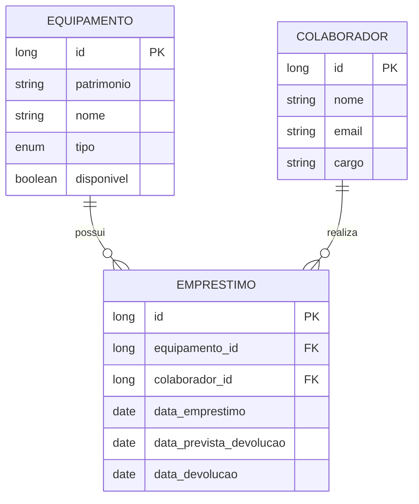

# 📦 EquipTrack API | Gestão de Empréstimos de Equipamentos

<div align="center">

**Java • Spring Boot • API REST • Spring Security • JWT • JPA • H2**


API REST para gerenciamento de empréstimos de equipamentos corporativos, desenvolvida com **Java 21 e Spring Boot**, com foco em regras de negócio, persistência de dados, autenticação JWT e testes automatizados.

**Projeto 02 — Formação Java + IA | ElasTech**

**SoulCode Academy + PagBank**

[](https://equiptrack-api-ss5x.onrender.com/swagger-ui/index.html)
[](https://github.com/mdouracyfreire/equiptrack-api/actions)

</div>

---

## 📖 Sobre o projeto

O **EquipTrack API** foi desenvolvido como o **Projeto 02 da Formação Java + IA — ElasTech**, promovida pela **SoulCode Academy em parceria com o PagBank**.

A aplicação simula o gerenciamento de equipamentos de uma organização, permitindo cadastrar equipamentos e colaboradores, registrar empréstimos, acompanhar a disponibilidade dos recursos e controlar devoluções.

O projeto utiliza uma **arquitetura em camadas**, com separação de responsabilidades, validação de dados, tratamento de exceções e proteção dos endpoints por meio de autenticação JWT.

### ⚙️ Funcionalidades

| Módulo | Funcionalidades |
|---|---|
| 📦 **Equipamentos** | Cadastro, listagem, consulta, atualização, exclusão e controle de disponibilidade |
| 👥 **Colaboradores** | Cadastro, consulta e associação aos empréstimos |
| 🔄 **Empréstimos** | Registro e acompanhamento dos empréstimos |
| 📥 **Devoluções** | Registro da devolução e liberação dos equipamentos |
| 📅 **Prazos** | Controle das datas previstas e identificação de atrasos |
| 🔐 **Segurança** | Autenticação JWT e autorização baseada em perfis |
| 📝 **Validações** | Validação dos dados e tratamento de operações inválidas |

Os equipamentos são classificados nos tipos `NOTEBOOK`, `MONITOR` e `HEADSET`.

---

## 🛠️ Tecnologias utilizadas

| Tecnologia | Finalidade |
|---|---|
| **Java 21** | Linguagem de programação |
| **Spring Boot 4** | Desenvolvimento da API REST |
| **Spring Data JPA / Hibernate** | Persistência e mapeamento objeto-relacional |
| **H2 Database** | Banco de dados relacional em memória |
| **Spring Security / JWT** | Autenticação e autorização |
| **BCrypt** | Proteção das senhas |
| **Jakarta Validation** | Validação dos dados |
| **Swagger / OpenAPI** | Documentação interativa |
| **JUnit 5 / Mockito / MockMvc** | Testes automatizados |
| **Apache Maven** | Gerenciamento de dependências e build |
| **Docker** | Conteinerização |
| **GitHub Actions** | Integração contínua |
| **Render** | Hospedagem da API |

---

## 🏗️ Arquitetura do projeto

A aplicação foi organizada em camadas, separando o recebimento das requisições HTTP, o processamento das regras de negócio e o acesso aos dados.

### Fluxo da aplicação


### Estrutura principal

```text
src/
├── main/
│   ├── java/com/empresa/emprestimos/
│   │   ├── config/
│   │   ├── controller/
│   │   ├── dto/
│   │   ├── exception/
│   │   ├── model/
│   │   ├── repository/
│   │   ├── security/
│   │   ├── service/
│   │   └── SistemaEmprestimosApplication.java
│   │
│   └── resources/
│       └── application.properties
│
└── test/
    ├── java/com/empresa/emprestimos/
    └── resources/
```

---

## 🗃️ Modelagem de dados

O sistema utiliza três entidades principais:

- **Equipamento:** representa os recursos cadastrados e sua disponibilidade.
- **Colaborador:** representa os profissionais que recebem os equipamentos.
- **Empréstimo:** registra a associação entre equipamento e colaborador, incluindo as datas de empréstimo e devolução.

### Diagrama de relacionamentos



### 📋 Principais regras de negócio

- Cada equipamento deve possuir um patrimônio único.
- Somente equipamentos disponíveis podem ser emprestados.
- Cada empréstimo deve estar associado a um equipamento e a um colaborador.
- Ao registrar um empréstimo, o equipamento torna-se indisponível.
- Após a devolução, o equipamento volta a ficar disponível.
- Equipamentos com histórico de empréstimos não podem ser excluídos.

---

## 🔐 Autenticação e autorização

O EquipTrack API utiliza **Spring Security e JWT** para proteger seus endpoints.

O acesso é controlado por dois perfis:

| Perfil | Permissões |
|---|---|
| `ADMIN` | Operações administrativas, incluindo cadastro de equipamentos |
| `COLABORADOR` | Consultas e operações autorizadas de empréstimo e devolução |

A autenticação é realizada pelo endpoint:

```http
POST /auth/login
```

Após a validação das credenciais, a API retorna um token JWT, que deve ser enviado nas requisições protegidas:

```http
Authorization: Bearer SEU_TOKEN_JWT
```

As senhas são armazenadas utilizando **BCrypt**.

---

## 🌐 Endpoints da API

### 📦 Equipamentos

| Método | Endpoint | Descrição |
|---|---|---|
| `POST` | `/equipamentos` | Cadastrar equipamento |
| `GET` | `/equipamentos` | Listar e filtrar equipamentos |
| `GET` | `/equipamentos/{id}` | Consultar equipamento por ID |
| `PUT` | `/equipamentos/{id}` | Atualizar equipamento |
| `DELETE` | `/equipamentos/{id}` | Excluir equipamento |

### 👥 Colaboradores

| Método | Endpoint | Descrição |
|---|---|---|
| `POST` | `/colaboradores` | Cadastrar colaborador |
| `GET` | `/colaboradores` | Listar colaboradores |
| `GET` | `/colaboradores/{id}` | Consultar colaborador por ID |

### 🔄 Empréstimos

| Método | Endpoint | Descrição |
|---|---|---|
| `POST` | `/emprestimos` | Registrar empréstimo |
| `GET` | `/emprestimos` | Listar empréstimos |
| `GET` | `/emprestimos/{id}` | Consultar empréstimo |
| `PUT` | `/emprestimos/{id}/devolucao` | Registrar devolução |

### 🔑 Autenticação

| Método | Endpoint | Descrição |
|---|---|---|
| `POST` | `/auth/login` | Autenticar usuário e gerar token JWT |

> Os parâmetros, corpos das requisições e contratos de resposta podem ser consultados na documentação Swagger.

---

## 📚 Documentação e testes da API

A API disponibiliza documentação interativa com **Swagger/OpenAPI**, permitindo consultar e executar os endpoints diretamente pelo navegador.

### Acessar o Swagger

**Ambiente local:**

```text
http://localhost:8080/swagger-ui/index.html
```

**Ambiente publicado:**

**[🔗 Acessar Swagger UI — Render](https://equiptrack-api-ss5x.onrender.com/swagger-ui/index.html)**

### Como testar endpoints protegidos

1. Acesse o Swagger UI.
2. Execute `POST /auth/login` com credenciais válidas.
3. Copie o token JWT retornado.
4. Clique em **Authorize**, no topo da interface.
5. Insira o token no campo de autenticação.
6. Execute os endpoints permitidos ao perfil autenticado.

### Exemplo de cadastro de equipamento

**Endpoint:** `POST /equipamentos`

**Perfil:** `ADMIN`

```json
{
  "patrimonio": "NOTE-003",
  "nome": "Notebook Samsung",
  "tipo": "NOTEBOOK"
}
```

O identificador é gerado automaticamente pelo banco de dados, enquanto a disponibilidade inicial é definida pelo sistema.

**Resposta esperada:** `201 Created`.

---

## 💻 Como executar o projeto

### Pré-requisitos

- Java JDK 21
- Git
- IntelliJ IDEA ou outra IDE Java compatível

O projeto inclui o **Maven Wrapper**, dispensando a instalação global do Maven.

### 1. Clonar o repositório

```bash
git clone https://github.com/mdouracyfreire/equiptrack-api.git
cd equiptrack-api
```

### 2. Configurar as variáveis de ambiente

| Variável | Finalidade |
|---|---|
| `JWT_SEGREDO` | Chave secreta JWT com pelo menos 32 bytes |
| `ADMIN_SENHA` | Senha inicial do administrador |
| `COLABORADOR_SENHA` | Senha inicial do colaborador |
| `PORT` | Porta HTTP (padrão: `8080`) |

No IntelliJ IDEA, configure as variáveis em:

**Run → Edit Configurations → Environment variables**

> [!IMPORTANT]
> Nunca publique senhas, tokens ou chaves secretas no repositório.

### 3. Executar a aplicação

Abra o projeto no IntelliJ IDEA e execute a classe:

```text
src/main/java/com/empresa/emprestimos/SistemaEmprestimosApplication.java
```

Ou utilize o terminal:

```bash
./mvnw spring-boot:run
```

A API estará disponível em:

```text
http://localhost:8080
```

> [!NOTE]
> O projeto utiliza H2 em memória. Os registros são perdidos quando a aplicação é reiniciada.

---

## 🧪 Testes automatizados e integração contínua

O projeto possui **33 testes automatizados**, abrangendo regras de negócio, controladores REST, relacionamentos JPA e segurança.

### Executar os testes

```bash
./mvnw clean test
```

### Executar a verificação completa

```bash
./mvnw clean verify
```

Os testes utilizam configurações próprias em `src/test/resources/application.properties`.

### 🔄 GitHub Actions

O repositório possui um workflow de integração contínua configurado em:

```text
.github/workflows/testes.yml
```

O workflow executa os testes automatizados em eventos de `push` e `pull_request`, além de permitir execução manual.

**[🔗 Consultar execuções no GitHub Actions](https://github.com/mdouracyfreire/equiptrack-api/actions)**

---

## 🐳 Docker e deploy

A aplicação possui um `Dockerfile` com construção em múltiplas etapas (*multi-stage build*).

### Construir a imagem

```bash
docker build -t equiptrack-api .
```

### Executar o contêiner

```bash
docker run --rm -p 8080:8080 \
  -e JWT_SEGREDO="SUA_CHAVE_SEGURA_COM_PELO_MENOS_32_BYTES" \
  -e ADMIN_SENHA="SUA_SENHA_ADMIN" \
  -e COLABORADOR_SENHA="SUA_SENHA_COLABORADOR" \
  equiptrack-api
```

Substitua os valores ilustrativos por credenciais seguras.

### ☁️ Deploy no Render

A API foi publicada na plataforma **Render**, utilizando Docker.

| Recurso | Link |
|---|---|
| 🌐 **API publicada** | [EquipTrack API](https://equiptrack-api-ss5x.onrender.com) |
| 📚 **Swagger UI** | [Documentação interativa](https://equiptrack-api-ss5x.onrender.com/swagger-ui/index.html) |
| 💚 **Health Check** | [Monitoramento da aplicação](https://equiptrack-api-ss5x.onrender.com/actuator/health) |

> [!NOTE]
> Como o banco H2 está configurado em memória, os registros não são preservados após reinicializações da aplicação.

---

## 🎥 Demonstração do projeto

Espaço reservado para o vídeo de apresentação técnica e demonstração das funcionalidades do **EquipTrack API**.

<div align="center">

**🎬 Vídeo de demonstração em preparação**

*Apresentação da arquitetura, autenticação JWT e execução das principais operações da API.*

</div>

---

## 📚 Aprendizados

Durante o desenvolvimento deste projeto, foram praticados conceitos importantes de desenvolvimento Back-end com Java, como:

- Programação Orientada a Objetos e arquitetura em camadas.
- Desenvolvimento de APIs REST com Spring Boot.
- Persistência de dados e relacionamentos com JPA/Hibernate.
- Implementação de regras de negócio e validações.
- Autenticação e autorização com Spring Security e JWT.
- Testes unitários e de integração com JUnit, Mockito e MockMvc.
- Documentação interativa com Swagger/OpenAPI.
- Integração contínua com GitHub Actions.
- Conteinerização com Docker e deploy no Render.
- Versionamento com Git e Conventional Commits.

O projeto contribuiu para consolidar conhecimentos de **desenvolvimento Back-end com Java**, reforçando a importância da segurança, da organização do código e da validação das regras de negócio.

---

## 🏁 Licença

Este projeto foi desenvolvido para fins educacionais como atividade proposta na **Formação Java + IA | ElasTech**, promovida pela **SoulCode Academy em parceria com o PagBank**.

O código está disponível para consulta e estudo. Nenhuma licença de reutilização foi definida formalmente.

---

## 👩‍💻 Autora

<div align="center">

Desenvolvido com 💛 por **Douracy Freire**

<a href="https://github.com/mdouracyfreire">
  
</a>

<a href="https://www.linkedin.com/in/douracy/">
  
</a>

</div>

---

<div align="center">

### 📦 EquipTrack API

**Java 21 • Spring Boot • API REST • Spring Security • JWT • JPA • H2**

*Projeto acadêmico desenvolvido com foco em aprendizagem, boas práticas e evolução técnica.*

**Projeto 02 — Formação Java + IA | ElasTech — SoulCode Academy + PagBank**

</div>
