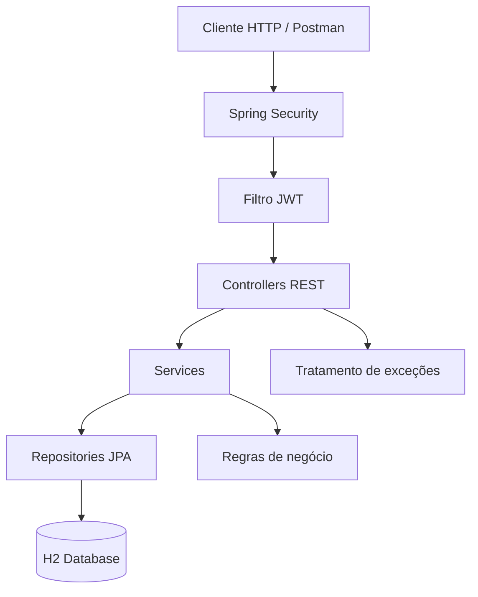
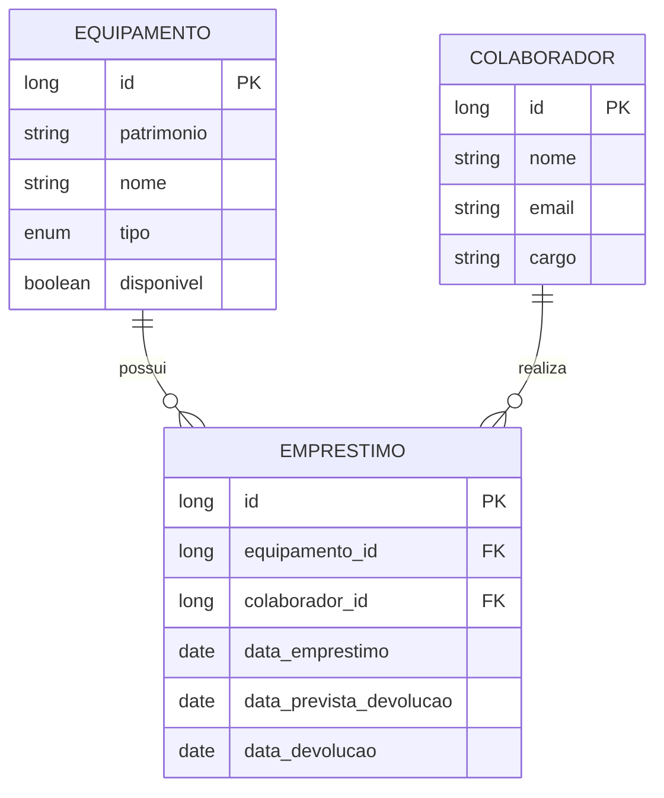
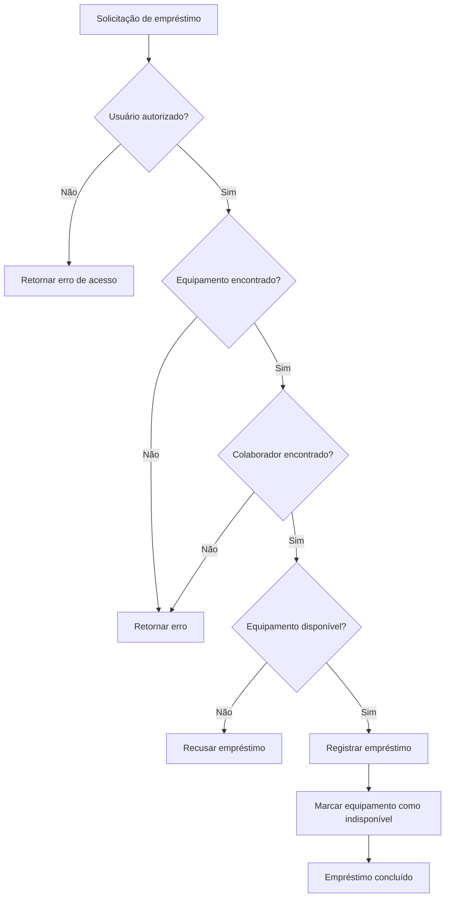
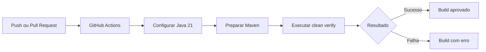

# 📦 EquipTrack API | Gestão de Empréstimos de Equipamentos

<div align="center">

**Java • Spring Boot • API REST • Spring Security • JWT • JPA • H2**


API REST para gerenciamento de empréstimos de equipamentos corporativos, desenvolvida com **Java 21 e Spring Boot**, com foco em regras de negócio, persistência de dados, autenticação, autorização e testes automatizados.

**Projeto 02 — Formação Java + IA | ElasTech**

**SoulCode Academy + PagBank**

</div>

---

## 📖 Sobre o projeto

O **EquipTrack API** foi desenvolvido como o **Projeto 02 da Formação Java + IA — ElasTech**, promovida pela **SoulCode Academy em parceria com o PagBank**.

A aplicação simula o gerenciamento de equipamentos de uma organização, permitindo cadastrar recursos e colaboradores, registrar empréstimos, acompanhar a disponibilidade dos equipamentos e controlar devoluções.

Diferentemente de uma aplicação executada diretamente no terminal, o EquipTrack disponibiliza suas funcionalidades por meio de uma **API REST**, possibilitando a comunicação com clientes HTTP, como Postman, aplicações web e outros sistemas.

Seu desenvolvimento prioriza a organização em camadas, a separação de responsabilidades, a consistência das regras de negócio e a proteção dos recursos por meio de autenticação JWT.

### 🎯 Objetivos

- Desenvolver uma API REST com Java e Spring Boot.
- Aplicar Programação Orientada a Objetos e arquitetura em camadas.
- Implementar persistência de dados com Spring Data JPA e Hibernate.
- Modelar relacionamentos entre equipamentos, colaboradores e empréstimos.
- Garantir a consistência das operações de empréstimo e devolução.
- Implementar validações e tratamento de exceções.
- Proteger endpoints utilizando Spring Security e JWT.
- Criar testes unitários e de integração.
- Documentar a API com Swagger/OpenAPI.
- Preparar a aplicação para integração contínua e conteinerização.

---

## ⚙️ Funcionalidades

| Módulo | Funcionalidades |
|---|---|
| 📦 **Equipamentos** | Cadastro, listagem, consulta e controle de disponibilidade |
| 👥 **Colaboradores** | Cadastro, consulta e associação aos empréstimos |
| 🔄 **Empréstimos** | Registro de empréstimos e associação entre equipamentos e colaboradores |
| 📥 **Devoluções** | Registro da devolução e liberação do equipamento |
| 📅 **Prazos** | Controle das datas previstas e identificação de empréstimos atrasados |
| 🛡️ **Segurança** | Autenticação JWT e autorização baseada em perfis |
| 📝 **Validações** | Verificação dos dados e tratamento de operações inválidas |
| 📚 **Documentação** | Interface interativa com Swagger/OpenAPI |
| 🧪 **Testes** | Testes unitários, de integração e de segurança |
| 🔄 **Integração contínua** | Workflow de testes com GitHub Actions |

### 📦 Equipamentos

A aplicação permite cadastrar e consultar equipamentos, identificados por patrimônio e classificados conforme seu tipo.

Categorias implementadas:

- `NOTEBOOK`
- `MONITOR`
- `HEADSET`

Cada equipamento possui um estado de disponibilidade, atualizado conforme as operações de empréstimo e devolução.

### 👥 Colaboradores

Os colaboradores são cadastrados com informações de identificação e podem ser associados aos empréstimos registrados.

### 🔄 Empréstimos e devoluções

O gerenciamento de empréstimos contempla:

- Associação entre equipamento e colaborador.
- Verificação da disponibilidade antes do empréstimo.
- Registro das datas relacionadas à operação.
- Controle dos equipamentos emprestados.
- Registro da devolução.
- Atualização da disponibilidade após a devolução.
- Consulta dos empréstimos realizados.

---

## 🛠️ Tecnologias utilizadas

| Tecnologia | Finalidade |
|---|---|
| **Java 21** | Linguagem de programação |
| **Spring Boot 4** | Estrutura principal da aplicação |
| **Spring Web MVC** | Desenvolvimento dos endpoints REST |
| **Spring Data JPA** | Persistência e acesso aos dados |
| **Hibernate** | Mapeamento objeto-relacional |
| **H2 Database** | Banco de dados relacional em memória |
| **Spring Security** | Autenticação e autorização |
| **JWT** | Geração e validação de tokens |
| **BCrypt** | Armazenamento seguro de senhas |
| **Jakarta Validation** | Validação de dados |
| **Swagger/OpenAPI** | Documentação interativa da API |
| **Spring Boot Actuator** | Monitoramento da aplicação |
| **JUnit 5** | Testes automatizados |
| **Mockito e MockMvc** | Testes de componentes e requisições HTTP |
| **Apache Maven** | Gerenciamento de dependências e build |
| **Docker** | Conteinerização da aplicação |
| **GitHub Actions** | Integração contínua |
| **Postman** | Testes manuais dos endpoints |
| **IntelliJ IDEA** | Ambiente de desenvolvimento |
| **Git e GitHub** | Versionamento e hospedagem do código |

---

## 🏗️ Arquitetura do projeto

A aplicação foi organizada em camadas, seguindo uma estrutura que separa o recebimento das requisições HTTP, o processamento das regras de negócio e o acesso aos dados.

### Fluxo da aplicação



### Estrutura de diretórios

```text
equiptrack-api/
│
├── .github/
│   └── workflows/
│       └── testes.yml
│
├── .mvn/
│   └── wrapper/
│
├── src/
│   ├── main/
│   │   ├── java/com/empresa/emprestimos/
│   │   │   ├── config/
│   │   │   ├── controller/
│   │   │   ├── dto/
│   │   │   ├── exception/
│   │   │   ├── model/
│   │   │   ├── repository/
│   │   │   ├── security/
│   │   │   ├── service/
│   │   │   └── SistemaEmprestimosApplication.java
│   │   │
│   │   └── resources/
│   │       └── application.properties
│   │
│   └── test/
│       ├── java/com/empresa/emprestimos/
│       │   ├── controller/
│       │   ├── model/
│       │   └── security/
│       │
│       └── resources/
│           └── application.properties
│
├── .dockerignore
├── .gitignore
├── Dockerfile
├── mvnw
├── mvnw.cmd
├── pom.xml
└── README.md
```

### Responsabilidades das camadas

| Camada | Responsabilidade |
|---|---|
| `model` | Representação das entidades e enumerações |
| `repository` | Operações de persistência com Spring Data JPA |
| `service` | Implementação das regras de negócio |
| `controller` | Recebimento de requisições e respostas HTTP |
| `dto` | Transferência de dados da autenticação |
| `security` | Validação de tokens e controle de acesso |
| `exception` | Tratamento centralizado de erros |
| `config` | Configurações da aplicação, Swagger e usuários iniciais |

Essa organização facilita a manutenção, a realização de testes e a evolução da aplicação.

---

## 🗃️ Modelagem de dados

A aplicação utiliza três entidades principais para representar o domínio de empréstimos:

- **Equipamento:** representa os recursos disponíveis para utilização.
- **Colaborador:** representa os profissionais que recebem equipamentos.
- **Empréstimo:** registra a associação entre um equipamento e um colaborador, incluindo as informações de empréstimo e devolução.

### Diagrama de relacionamentos



### Relacionamentos

| Relacionamento | Cardinalidade |
|---|---|
| Equipamento → Empréstimo | Um para muitos (1:N) |
| Colaborador → Empréstimo | Um para muitos (1:N) |

Um equipamento pode participar de diferentes empréstimos ao longo do tempo, mas não pode ser emprestado simultaneamente a mais de um colaborador.

Um colaborador pode possuir diferentes registros de empréstimo.

A persistência é realizada por meio do **Spring Data JPA**, utilizando o Hibernate para o mapeamento entre as entidades Java e as tabelas do banco de dados.

---

## 📋 Regras de negócio

As regras implementadas buscam garantir a consistência dos registros e impedir operações inválidas.

| Regra | Comportamento |
|---|---|
| Patrimônio único | Impede o cadastro de equipamentos com patrimônio duplicado |
| Disponibilidade | Permite empréstimos somente de equipamentos disponíveis |
| Registro de empréstimo | Associa um equipamento a um colaborador |
| Atualização de estado | Marca o equipamento como indisponível após o empréstimo |
| Registro de devolução | Registra a devolução do equipamento |
| Liberação do equipamento | Atualiza a disponibilidade após a devolução |
| Validação de dados | Rejeita informações inválidas |
| Controle de acesso | Restringe operações conforme o perfil autenticado |

### 🔄 Fluxo de empréstimo



Na devolução, a aplicação registra a conclusão do empréstimo e libera o equipamento para novas solicitações.

---

## 🔐 Autenticação e autorização

O EquipTrack API utiliza **Spring Security** e **JSON Web Tokens (JWT)** para proteger seus endpoints.

O processo de autenticação funciona da seguinte maneira:

1. O usuário informa suas credenciais.
2. A aplicação verifica os dados de autenticação.
3. Um token JWT é gerado após a autenticação.
4. O cliente envia o token nas requisições protegidas.
5. O filtro de segurança valida o token.
6. A operação é autorizada ou recusada conforme o perfil do usuário.

### Perfis de acesso

| Perfil | Permissões |
|---|---|
| `ADMIN` | Acesso administrativo, incluindo cadastro de equipamentos |
| `COLABORADOR` | Acesso às operações autorizadas de consulta, empréstimo e devolução |

### Exemplo de autenticação

```http
POST /auth/login
Content-Type: application/json
```

O corpo da requisição deve conter as credenciais esperadas pelo endpoint de autenticação.

Após obter um token válido, ele deve ser enviado nas requisições protegidas:

```http
Authorization: Bearer SEU_TOKEN_JWT
```

### Códigos HTTP de segurança

| Código | Significado |
|---|---|
| `200 OK` | Requisição autorizada e processada |
| `401 Unauthorized` | Autenticação ausente ou inválida |
| `403 Forbidden` | Usuário autenticado sem permissão |
| `201 Created` | Recurso criado com sucesso |

A aplicação utiliza BCrypt para proteger as senhas armazenadas.

---

## 🌐 API REST

Os recursos são disponibilizados por meio de endpoints HTTP.

### Equipamentos

| Método | Endpoint | Descrição |
|---|---|---|
| `POST` | `/equipamentos` | Cadastrar equipamento |
| `GET` | `/equipamentos` | Listar equipamentos |
| `GET` | `/equipamentos/{id}` | Consultar equipamento por ID |

### Colaboradores

| Método | Endpoint | Descrição |
|---|---|---|
| `POST` | `/colaboradores` | Cadastrar colaborador |
| `GET` | `/colaboradores` | Listar colaboradores |
| `GET` | `/colaboradores/{id}` | Consultar colaborador por ID |

### Empréstimos

| Método | Endpoint | Descrição |
|---|---|---|
| `POST` | `/emprestimos` | Registrar empréstimo |
| `GET` | `/emprestimos` | Listar empréstimos |
| `GET` | `/emprestimos/{id}` | Consultar empréstimo |
| `PUT` | `/emprestimos/{id}/devolucao` | Registrar devolução |

### Autenticação

| Método | Endpoint | Descrição |
|---|---|---|
| `POST` | `/auth/login` | Autenticar usuário e gerar token |

> **Observação:** os exemplos de requisição, os campos obrigatórios e os contratos completos podem ser consultados na documentação Swagger da aplicação.

---

## 📚 Documentação Swagger/OpenAPI

A API possui documentação interativa utilizando Swagger/OpenAPI.

Com a aplicação em execução, acesse:

```text
http://localhost:8080/swagger-ui/index.html
```

A interface permite:

- Consultar os endpoints disponíveis.
- Visualizar os métodos HTTP.
- Examinar os parâmetros e corpos das requisições.
- Consultar os formatos de resposta.
- Testar operações diretamente pelo navegador.

A especificação OpenAPI pode ser consultada em:

```text
http://localhost:8080/v3/api-docs
```

---

## 🎥 Demonstração do projeto

Esta seção será utilizada para disponibilizar o vídeo de apresentação técnica e demonstração prática do **EquipTrack API**.

O vídeo poderá apresentar a arquitetura da aplicação, a autenticação JWT, as principais operações REST e a execução dos testes automatizados.

<div align="center">

**🎬 Vídeo de demonstração em preparação**

*Apresentação técnica e demonstração das funcionalidades da API.*

</div>

---

## 💻 Como executar o projeto

### Pré-requisitos

Para executar a aplicação localmente, é necessário ter:

- Java JDK 21.
- Git.
- IntelliJ IDEA ou outra IDE Java compatível.

O projeto inclui o **Maven Wrapper**, dispensando a instalação global do Maven.

### 1. Clonar o repositório

```bash
git clone https://github.com/mdouracyfreire/equiptrack-api.git
```

Acesse o diretório:

```bash
cd equiptrack-api
```

### 2. Verificar a versão do Java

```bash
java -version
```

A versão utilizada no projeto é o Java 21.

### 3. Configurar as variáveis de ambiente

A aplicação utiliza variáveis de ambiente para definir informações sensíveis e parâmetros de execução.

| Variável | Finalidade |
|---|---|
| `JWT_SEGREDO` | Chave secreta para assinatura dos tokens JWT |
| `ADMIN_SENHA` | Senha inicial do usuário administrador |
| `COLABORADOR_SENHA` | Senha inicial do usuário colaborador |
| `PORT` | Porta HTTP, com valor padrão `8080` |

A chave JWT deve possuir pelo menos 32 bytes.

No IntelliJ IDEA, acesse:

**Run → Edit Configurations → Environment variables**

Configure as variáveis necessárias antes de iniciar a aplicação.

> [!IMPORTANT]
> Nunca publique senhas, tokens ou chaves secretas no repositório. Utilize valores próprios e seguros no ambiente de execução.

### 4. Executar a aplicação

Abra o projeto no IntelliJ IDEA e aguarde a sincronização do Maven.

Localize a classe:

```text
src/main/java/com/empresa/emprestimos/SistemaEmprestimosApplication.java
```

Execute o método `main()`.

Alternativamente, com as variáveis de ambiente configuradas no terminal, utilize:

```bash
./mvnw spring-boot:run
```

A aplicação estará disponível em:

```text
http://localhost:8080
```

### 5. Testar a API

Utilize o Postman ou o Swagger para realizar as requisições HTTP.

Para acessar recursos protegidos:

1. Realize a autenticação.
2. Copie o token JWT recebido.
3. Adicione o token ao cabeçalho `Authorization`.
4. Execute as operações permitidas ao perfil autenticado.

### 6. Consultar o monitoramento

O Spring Boot Actuator disponibiliza informações sobre a saúde da aplicação:

```text
http://localhost:8080/actuator/health
```

---

## 🗄️ Banco de dados H2

O projeto utiliza o **H2 Database**, configurado como banco de dados em memória.

Configuração principal:

```properties
spring.datasource.url=jdbc:h2:mem:emprestimosdb
spring.datasource.driver-class-name=org.h2.Driver
spring.datasource.username=sa
spring.datasource.password=
```

A estrutura das tabelas é gerenciada pelo Hibernate por meio do Spring Data JPA.

> [!NOTE]
> Como o banco está configurado em memória, os dados são perdidos quando a aplicação é encerrada ou reiniciada. Essa configuração é adequada para demonstrações e desenvolvimento, mas não oferece persistência permanente.

---

## 🧪 Testes automatizados

O projeto possui **33 testes automatizados**, distribuídos entre testes unitários, testes de integração e testes de segurança.

As verificações contemplam comportamentos das entidades, operações dos controladores, relacionamentos entre registros e restrições de acesso.

### Cenários contemplados

| Cenário | Finalidade |
|---|---|
| Entidades | Verificar comportamentos e validações do domínio |
| Equipamentos | Validar operações de cadastro e consulta |
| Empréstimos | Verificar o registro e o processamento das operações |
| Relacionamentos JPA | Validar a associação entre entidades |
| Controladores REST | Verificar respostas HTTP |
| Autenticação | Rejeitar requisições sem token válido |
| Autorização | Bloquear operações não permitidas ao perfil |
| Acesso administrativo | Permitir operações autorizadas ao administrador |

### Executar todos os testes

```bash
./mvnw clean test
```

### Executar os testes de segurança

```bash
./mvnw -Dtest=SegurancaIntegrationTest test
```

### Executar a verificação completa do Maven

```bash
./mvnw clean verify
```

Os testes utilizam configurações próprias em:

```text
src/test/resources/application.properties
```

Isso permite executar a suíte sem depender das credenciais utilizadas no ambiente principal.

---

## 🔄 Integração contínua com GitHub Actions

O projeto possui um workflow configurado para executar os testes automatizados.

Arquivo:

```text
.github/workflows/testes.yml
```

### Fluxo de integração contínua



O workflow foi configurado para:

- Executar em eventos de `push`.
- Executar em `pull_request`.
- Permitir execução manual.
- Preparar o ambiente Java 21.
- Utilizar o Maven Wrapper.
- Executar os testes automatizados.

O resultado das execuções pode ser acompanhado na aba **Actions** do repositório.

---

## 🐳 Docker

A aplicação possui um `Dockerfile` com construção em múltiplas etapas (*multi-stage build*).

A primeira etapa utiliza o Java 21 para compilar o projeto. A segunda prepara uma imagem de execução com o JRE.

### Construir a imagem

```bash
docker build -t equiptrack-api .
```

### Executar o contêiner

```bash
docker run --rm -p 8080:8080 \
  -e JWT_SEGREDO="SUA_CHAVE_SEGURA" \
  -e ADMIN_SENHA="SUA_SENHA_ADMIN" \
  -e COLABORADOR_SENHA="SUA_SENHA_COLABORADOR" \
  equiptrack-api
```

Substitua os valores ilustrativos por credenciais seguras.

A API ficará disponível em:

```text
http://localhost:8080
```

> [!NOTE]
> A configuração Docker foi preparada para a execução da aplicação. A validação da construção da imagem depende de um ambiente com Docker disponível.

---

## 📚 Aprendizados

Durante o desenvolvimento deste projeto, foram praticados conceitos importantes de desenvolvimento Back-end com Java, como:

- Programação Orientada a Objetos (POO).
- Desenvolvimento de APIs REST com Spring Boot.
- Arquitetura em camadas e separação de responsabilidades.
- Injeção de dependências.
- Implementação de controladores e serviços.
- Persistência de dados com Spring Data JPA.
- Mapeamento objeto-relacional com Hibernate.
- Relacionamentos entre entidades.
- Aplicação de regras de negócio.
- Validação de dados e tratamento de exceções.
- Utilização de códigos de resposta HTTP.
- Autenticação e autorização com Spring Security.
- Geração e validação de tokens JWT.
- Proteção de senhas com BCrypt.
- Desenvolvimento de testes unitários e de integração.
- Testes de endpoints utilizando MockMvc.
- Documentação de APIs com Swagger/OpenAPI.
- Gerenciamento de dependências com Maven.
- Configuração de integração contínua com GitHub Actions.
- Introdução à conteinerização com Docker.
- Versionamento com Git e Conventional Commits.

O projeto contribuiu para consolidar conhecimentos de **desenvolvimento Back-end com Java**, reforçando a importância da segurança, da organização do código e da validação das regras de negócio.

---

## 🎓 Contexto acadêmico

O **EquipTrack API** foi desenvolvido para fins educacionais como **Projeto 02 da Formação Java + IA — ElasTech**, promovida pela **SoulCode Academy em parceria com o PagBank**.

A atividade teve como objetivo aplicar conceitos de desenvolvimento de aplicações Java, construção de APIs REST, persistência de dados, segurança e testes automatizados.

O repositório está disponível para consulta e como referência de estudo, demonstrando os conhecimentos adquiridos e aplicados durante a formação.

---

## 🏁 Licença

Este projeto foi desenvolvido para fins educacionais como atividade proposta na **Formação Java + IA | ElasTech**, promovida pela **SoulCode Academy em parceria com o PagBank**.

O código está disponível para consulta e estudo. Nenhuma licença de reutilização foi definida formalmente.

---

## 👩‍💻 Autora

<div align="center">

Desenvolvido com 💛 por **Douracy Freire**

<a href="https://github.com/mdouracyfreire">
  
</a>

<a href="https://www.linkedin.com/in/douracy/">
  
</a>

</div>

---

<div align="center">

### 📦 EquipTrack API

**Java 21 • Spring Boot • API REST • Spring Security • JWT • JPA • H2**

*Projeto acadêmico desenvolvido com foco em aprendizagem, boas práticas e evolução técnica.*

**Projeto 02 — Formação Java + IA | ElasTech — SoulCode Academy + PagBank**

</div>
